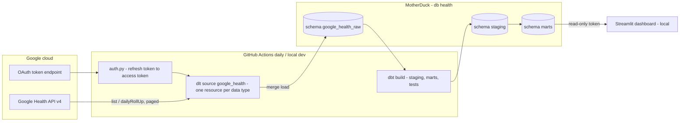

# Google Health To MotherDuck Pipeline Design

Status: proposed architecture; the M0 API spike comes before any build work.
Date: 2026-10-27.
Intent: [intent](intent.md). Delivery: [implementation plan](implementation-plan.md).
Related: [SportBud design](../20261019_init_app/design.md) (separate scope; same ownership rule).

## 1. Recommendation

Build a **Python-only batch pipeline**:

- **dlt** extracts from the **Google Health API** (`health.googleapis.com/v4`) once a day.
- **MotherDuck** stores the data.
- **dbt-core 1.12 + dbt-duckdb 1.11** builds the analysis models.
- **Streamlit** serves the dashboard.
- **GitHub Actions** runs the daily schedule.

**Data ownership rule:** personal data may live in the cloud only in accounts the user owns and manages. The app builder never reads it. Each user therefore runs their **own copy** of the pipeline: their own Google Cloud project and OAuth client, MotherDuck account, and private GitHub repo. The builder ships code only. There is no shared backend, no builder-held tokens and no telemetry.

Every part is Python or SQL, which matches your strongest skills. DuckDB SQL works the same against a local `.duckdb` file and against MotherDuck, so you can develop and test locally without the cloud.

| Layer | Choice | Why | Alternative |
| --- | --- | --- | --- |
| Extract/load | dlt (custom source on `RESTClient`) | Required by the intent. It handles incremental state, schema evolution, nested JSON and merge loads. | `rest_api` declarative source: less code, but harder to manage OAuth refresh and per-kind filters. |
| Warehouse | MotherDuck (`md:` destination); local `duckdb` for dev/CI | Required by the intent. Serverless, with no infrastructure to run. Same SQL dialect locally. | Local DuckDB only (see decision D1). |
| Transform | **dbt-core 1.12.x + dbt-duckdb[md] 1.11.x** (latest v1 line) | Decided 2026-10-28. Mature, Apache-2.0 open source, installed with uv alongside dlt. Full `dbt-duckdb` features, with MotherDuck through `md:` paths. | dbt v2 (Fusion) later, once its DuckDB adapter matches v1 features. |
| Dashboard | Streamlit + Plotly | Pure Python, quick to iterate, runs locally. | Evidence.dev (SQL + Markdown, JS build), or MotherDuck's own UI for ad hoc SQL. |
| Schedule | GitHub Actions cron (private repo) | Free, keeps secrets, gives run history, needs no server. | macOS `launchd` (fully local, but only runs when the Mac is awake). |
| Tooling | `uv`, Ruff, Pyright, pytest | Same as the SportBud plan. | — |

Out of scope: Airflow/Dagster, Kafka/streaming, webhooks, Docker/Kubernetes, and a custom web backend. One daily batch for one user does not need them.

## 2. Platform Facts That Shape The Design

Checked 2026-10-27. Recheck before implementation.

- **Primary device: Google Fitbit Air.** It syncs over Bluetooth to the Google Health app, which uploads to your Google Health account. The Google Health API reads that account. The Air has no GPS. It tracks steps, distance, calories, heart rate (with zones during exercise), automatic sleep stages, auto-detected exercise, SpO2 during sleep, and irregular rhythm notifications. Some advanced metrics need Google Health Premium. Sync is automatic but not instant (about every 15 minutes when the app is running).
- **Google Fit REST APIs are deprecated** and have been closed to new developers since 2024. Do not build on them.
- **Health Connect is on-device only** (Android SDK). It has no server-side REST API, so a cloud pipeline cannot read it directly.
- **The Google Health API is the supported server API.** It replaces the Fitbit Web API, which shuts down on 2026-11-02. It serves data from Fitbit, Pixel Watch and other sources. Whether data written by Android apps through Health Connect appears there is **not confirmed**. The M0 spike verifies this with your own account.
- Read methods per data type: `list` (raw points with `dataSource`), `reconcile` (one merged stream), `rollUp` (physical-time windows) and `dailyRollUp` (civil-day windows). Some types only support rollups (`total-calories`, `floors`, `calories-in-heart-rate-zone`).
- Pagination uses `pageToken`/`nextPageToken`. The page size limit is 10,000, but only 25 for `exercise` and `sleep`.
- Rate limit: **300 requests/minute per user**. Unverified apps are capped at 100 users. Retry `429`/`504` with exponential backoff.
- Interval and session points carry `startUtcOffset`/`endUtcOffset`. Daily types use a civil `date`. History is available back to the first recorded data.
- Scopes are `https://www.googleapis.com/auth/googlehealth.<bundle>.readonly`. All `googlehealth.*` scopes are **restricted**: a multi-user production app needs Google's privacy and security review.
- OAuth apps in **Testing** status with external users get refresh tokens that **expire after 7 days**. A daily unattended job needs the app moved to "In production" (unverified, personal use, 100-user cap) or a weekly re-consent. M0 verifies this (see risk R1).

## 3. Scope Decisions To Confirm

| # | Decision | Recommendation |
| --- | --- | --- |
| D1 | ~~Cloud storage vs the SportBud "no cloud" constraint.~~ **Resolved 2026-10-28:** cloud storage is allowed when the user owns and manages the account, and the app builder never reads the data. | MotherDuck in the user's own account is allowed. Keep the destination as a single config switch (`duckdb` ↔ `motherduck`) so local-only mode stays available. Any SportBud link to this data is a later, explicit opt-in. |
| D2 | "People" in the intent suggests several users. | **Self-hosted, one deployment per person.** Each user creates their own Google Cloud project/OAuth client, MotherDuck account and private repo from a template, and is the only user of their own OAuth app (personal use). This avoids a central multi-user app, restricted-scope verification and builder access to data. v1 is built and tested on your account. A setup guide for other people comes later. |
| D3 | Which data types to extract. | Start with a **core set** (section 5) and add types through configuration. Exclude ECG, IRN, location/GPS, nutrition and reproductive-health data (least privilege). |

## 4. Architecture



Run order for each day: refresh the access token → dlt extract/normalize/load → `dbt build` (models plus tests) → done. The job fails loudly if anything goes wrong, and the next run catches up automatically because dlt state stores the cursors.

### Component Ownership

| Component | Owns | Must not |
| --- | --- | --- |
| `auth` | Exchange the refresh token for an access token; consent, re-auth and Keychain helpers (section 9). | Log tokens or write them to disk. |
| `google_health` dlt source | Data-type registry, filters per kind, pagination, backoff, incremental cursors, primary keys. | Transform business logic or compute aggregates (except for rollup-only types). |
| dlt pipeline | Schema inference, nested tables, state, merge into `google_health_raw`. | Be edited by hand in the warehouse. |
| dbt project | Typing, local-time derivation, deduplication, daily marts, data tests. | Call the API. |
| Streamlit app | Read marts and draw charts. | Write to the warehouse, or use the read/write token. |

## 5. Extraction Design

### Data-Type Registry

One declarative entry per type drives a generic resource factory:

```python
DataTypeSpec(
    id="steps", kind="interval", method="list",
    scope="activity_and_fitness", cursor="interval.endTime",
    lookback_days=3, page_size=10_000,
)
```

Core v1 set, matched to what the Fitbit Air records. "Verify" means the M0 spike confirms the Air fills this type for your account.

| Data type | Kind | Method | Purpose | Air |
| --- | --- | --- | --- | --- |
| `steps`, `distance` | interval | list | Daily activity volume | Yes |
| `active-zone-minutes`, `time-in-heart-rate-zone` | interval | list | Intensity / cardio load proxy | Verify |
| `total-calories` | interval | dailyRollUp | Energy (`list` is not supported) | Yes |
| `heart-rate` | sample | list | Intraday HR (largest volume) | Yes |
| `daily-resting-heart-rate` | daily | list | Recovery trend | Verify |
| `daily-heart-rate-variability`, `daily-oxygen-saturation` | daily | list | Overnight recovery (SpO2 not available in every region) | Verify |
| `sleep` | session | list | Duration, stages, efficiency | Yes |
| `exercise` | session | list | Auto-detected and tagged workouts (no GPS route) | Yes |
| `weight` | sample | list | Only if logged manually or from a scale (optional) | No |

Not extracted: `irregular-rhythm-notification` (medical data, separate restricted scope) and location (the Air has no GPS).

Scopes requested: `activity_and_fitness.readonly`, `health_metrics_and_measurements.readonly`, `sleep.readonly`, `profile.readonly`, nothing else.

### Incremental Strategy

- Each resource uses `dlt.sources.incremental` on its end/sample time (or `date` for daily types). The cursor is stored in dlt pipeline state, which lives in the destination, so CI runners need no local state.
- **Lookback window**: every run re-reads `[cursor - lookback_days, now]`. Wearables sync late, and sleep sessions finish the next morning. `write_disposition="merge"` on the data point's `name` (its resource id) makes re-reads idempotent.
- **Backfill**: `initial_value` comes from config (default: 2 years). The backfill runs in 30-day windows so it stays within rollup range limits and gives restartable progress. Expected API cost: about a few hundred requests in total, well under 300/min with simple pacing.
- **Source deletions/edits** older than the lookback are not detected. A weekly job re-reads the last 30 days and replaces that window per type (`merge` strategy `delete-insert` on a window key). This is a known limitation, documented in the dashboard.
- Use `list` (not `reconcile`) so per-source provenance (`dataSource`) is kept. dbt handles deduplication across devices (section 6).

### HTTP Client

- dlt `RESTClient` with `JSONResponseCursorPaginator(cursor_path="nextPageToken", cursor_param="pageToken")`.
- A custom `AuthConfigBase` that uses `google-auth` `Credentials.refresh()`.
- Retries on 429/5xx with exponential backoff and jitter; a client-side limit of ≤ 4 requests/second.
- The M0 spike confirms the exact filter syntax per kind (e.g. `interval.start_time` and `sample_time.physical_time` filters) against the REST reference before the registry is finalized.

## 6. Data Model

Database `health` (MotherDuck), or `health.duckdb` locally.

| Schema | Built by | Contents |
| --- | --- | --- |
| `google_health_raw` | dlt | One table per data type (`steps`, `heart_rate`, …) plus nested child tables, `_dlt_loads`, `_dlt_pipeline_state`. Append-merge only. |
| `staging` | dbt views | `stg_<type>`: typed columns, `start_utc`/`end_utc`, `start_local` (UTC + offset), `local_date`, `source_device`, `source_platform`, deduplicated on `name`. |
| `marts` | dbt tables | Business-ready daily facts (below). |

Marts (one row per local date unless noted):

- `dim_date`: calendar, ISO week, weekday/weekend.
- `fct_daily_activity`: steps, distance_km, active_zone_minutes, total_calories.
- `fct_daily_recovery`: resting_hr, hrv_rmssd, sleep_minutes, sleep_efficiency, deep/rem/light minutes, bedtime/wake (local).
- `fct_workouts` (one row per exercise session): type, start_local, duration, distance, avg/max HR, calories.
- `fct_body` (one row per measurement): weight_kg, body_fat_pct.
- `fct_heart_rate_hourly`: min/avg/max HR per local hour. The dashboard uses this, never raw samples.

Rules:

- **Local day** = UTC timestamp + the point's own offset. Never the runner's time zone. A sleep session belongs to the date it **ends** on.
- **Cross-source duplicates** (phone and watch both counting steps): pick one preferred source per type through a dbt seed `source_priority.csv`. Do not add up overlapping sources.
- **Missing ≠ zero**: days with no data stay `NULL`, and charts show gaps.
- **dbt conventions:**
  - Pin `dbt-core==1.12.*` and `dbt-duckdb[md]==1.11.*` in `pyproject.toml`; `uv.lock` holds the exact versions. The `md` extra pins `duckdb==1.5.5`, and dlt uses that same `duckdb` package from the shared uv environment. Upgrade them together.
  - Declare the dlt raw tables as dbt `sources`, so dlt must load before `dbt build`. Use SQL models. Python models are available but not needed.
  - MotherDuck does not allow custom extensions or user-defined functions. Use core DuckDB SQL only.
  - Marts are small (one row per day), so build them as full-rebuild `table`s. Add `incremental` models only if a rebuild becomes slow.
  - Profile `prod`: `type: duckdb`, `path: "md:health"`, with the token taken from the `MOTHERDUCK_TOKEN` env var. Profile `dev`: `path: ./health.duckdb`.
- dbt tests: `unique`/`not_null` on keys, accepted ranges (HR 25–250, steps ≥ 0), and a freshness check (latest `local_date` ≥ today − 2).

## 7. Dashboard

Streamlit, run locally (`uv run streamlit run dashboard/app.py`). Pages:

1. **Overview**: last-7-day KPI tiles (steps, resting HR, HRV, sleep) with deltas against the 28-day average; data freshness badge.
2. **Activity**: daily steps/AZM bars with a 7-day rolling line; weekly totals.
3. **Recovery & sleep**: resting HR and HRV trends; sleep duration/stages stacked bars; bedtime consistency.
4. **Workouts**: table plus per-type volume over time; HR distribution.
5. **Body**: weight trend with a 7-day moving average.

It connects with a MotherDuck **read-scaling (read-only) token**. Query results are cached with `st.cache_data(ttl=3600)`. Do not deploy to Streamlit Community Cloud with health data unless you add app authentication. Keep it local for v1.

## 8. Security And Privacy

| Asset | Control |
| --- | --- |
| Ownership | Every account holding data or secrets (Google Cloud project, MotherDuck, GitHub repo and its Actions secrets) belongs to the user. The builder has no collaborator access, receives no logs or crash reports, and the code makes no network calls other than Google APIs and the user's MotherDuck. Support uses synthetic data only. |
| Credentials | OAuth client, refresh token and MotherDuck tokens: see section 9. |
| Health data | Never in the repo, CI logs, artifacts, fixtures or bug reports. dlt progress logging stays at `log` level, with no payload dumps. Tests use synthetic JSON fixtures only. |
| Scope creep | Only the 4 read-only bundles listed in section 5. |
| Revocation and deletion | Revoke at myaccount.google.com → the next run fails with `invalid_grant` → the alert tells you to re-consent. `DROP DATABASE health` in MotherDuck plus deleting the GitHub secrets removes everything. |
| Policy | Personal use of your own data under the Google Health API Developer and User Data Policy. Re-read it before sharing the dashboard or adding users. |

## 9. Credentials Management

All credentials belong to the user's own accounts (section 1 ownership rule). The builder never creates, sees or stores any of them.

### Inventory

| Credential | Grants | Lifetime | Local (Mac) | CI (GitHub Actions) |
| --- | --- | --- | --- | --- |
| OAuth client ID + secret (type "Desktop app") | Identifies the user's own Cloud project app | Until rotated | macOS Keychain | Environment secret |
| Google refresh token | **Read access to health data**: the most sensitive credential | Long-lived; lapses after 6 months unused, on revocation, or when pushed out by the 100-token limit | macOS Keychain | Environment secret |
| Google access token | One API call window | About 1 hour | Process memory only | Process memory only |
| MotherDuck read/write token | Pipeline load + dbt build | Until revoked; rotate about every 90 days | macOS Keychain | Environment secret |
| MotherDuck read-scaling token | Dashboard reads | Until revoked; rotate about every 90 days | macOS Keychain | Not stored (dashboard is local) |

Keychain entries use service `ghealth-pipeline` and keys `google_client_id`, `google_client_secret`, `google_refresh_token`, `motherduck_rw_token` and `motherduck_read_token`. GitHub uses the matching names in upper case.

### Flows

1. **Consent** (`scripts/consent.py`, run locally only):
   - Uses `google-auth-oauthlib` `InstalledAppFlow` with a loopback redirect. PKCE is handled by the library.
   - Asks for `access_type=offline` and the 4 read-only scopes only. Does not send `include_granted_scopes`.
   - Writes the refresh token straight to the Keychain with `keyring`. Never prints it and never writes it to a file.
2. **Runtime resolution:**
   - dlt resolves a typed `GcpOAuthCredentials` spec (`client_id`, `client_secret`, `refresh_token`) from env vars `SOURCES__GOOGLE_HEALTH__CREDENTIALS__CLIENT_ID`, `…__CLIENT_SECRET` and `…__REFRESH_TOKEN`. A missing value fails at startup before any API call.
   - dbt and dlt read `MOTHERDUCK_TOKEN`.
   - Locally, `scripts/run_local.py` loads Keychain entries into the child process environment for one run only.
   - In CI, the workflow maps environment secrets to the same names.
   - `.dlt/secrets.toml` is not used for these values. `.dlt/config.toml` holds only non-secret settings.
3. **Access token handling:** the custom `AuthConfigBase` gets an access token with the refresh token and keeps it only in memory. It refreshes 5 minutes before expiry, and on a `401` refreshes once and retries.
4. **Hard failure:** `invalid_grant` (revoked, expired or replaced token) is never retried. The run fails with "Re-consent required: run `make reauth`", which triggers the failed-workflow email.
5. **Re-auth and rotation** (`make reauth`):
   - Runs consent and updates the Keychain.
   - Pushes the new token to CI with `gh secret set GOOGLE_HEALTH_REFRESH_TOKEN --env production`, piped from stdin so it never appears on screen or in shell history.
   - Revokes the old token at `https://oauth2.googleapis.com/revoke`.
   - This is the **only** supported way to create a refresh token. That avoids hitting the 100-tokens-per-client limit and leaving CI on a stale token.
6. **MotherDuck rotation:** create a new token in the MotherDuck UI, update the Keychain and the GitHub secret, run `workflow_dispatch`, then revoke the old token.

### Controls

- **CI scope:**
  - Secrets live in a GitHub **environment** `production`, limited to the `main` branch.
  - The workflow has `permissions: contents: read` and triggers only on `schedule` and `workflow_dispatch` (never `pull_request`).
  - Third-party actions are pinned to a commit SHA.
  - Secrets go only into the env of the steps that need them.
- **No leakage:** never log tokens, `Authorization` headers or API response bodies. No HTTP debug logging. GitHub log masking is a safety net, not the control.
- **Repository:** gitignore `.dlt/secrets.toml`, `.env` and `*.duckdb`. Add a `gitleaks` pre-commit hook and turn on GitHub secret scanning with push protection.
- **Least privilege:** 4 read-only Google scopes. The dashboard uses only the read-scaling MotherDuck token. The pipeline token is never used by the dashboard.
- **Offboarding:**
  - Revoke app access at myaccount.google.com.
  - Delete the Keychain entries (`make forget-credentials`) and the GitHub environment secrets.
  - Revoke the MotherDuck tokens.
  - Optionally delete the OAuth client in the Cloud console.

## 10. Observability

- The GitHub Actions run fails on any extraction, load or `dbt test` error. Turn on GitHub's email notification for failed workflow runs.
- dlt `load_info` and per-table row counts are written to `_dlt_loads`, and a small `ops.run_log` table is appended (run id, types loaded, rows, duration, no payload).
- The dashboard shows "last successful load" and per-type latest date, so stale data is visible.

## 11. Risks

| # | Risk | Mitigation |
| --- | --- | --- |
| R1 | Refresh token expires every 7 days in OAuth Testing mode, which breaks the daily job. | M0: set the consent screen to "In production" (unverified, personal) and confirm the token survives longer than 7 days. Fallback: documented weekly `make reauth` plus updating the GitHub secret. |
| R2 | Some Fitbit Air metrics (HRV, cardio load, Premium-only features) are not exposed by the API, or data from other apps lives only in Health Connect. | Fitbit device data is the API's native source, so the core types are low risk. The M0 spike lists what your account actually returns, and the registry drops anything empty. Data that exists only in Health Connect would need an on-device export, which becomes a new design. |
| R3 | The new API (v4) changes behavior. | Pin API version paths, use contract tests on saved synthetic responses, and give dlt schema contracts `freeze` on columns used by dbt. |
| R4 | Heart-rate volume (tens of thousands of points/day). | Store raw HR, but the dashboard reads only hourly aggregates. Revisit if storage or cost becomes an issue. |
| R5 | Cloud storage of health data (D1). | Only in user-owned accounts. Least privilege, no builder access, local mode kept available. |
| R7 | dbt 1.x becomes the older line now that v2 is out, so new features and eventually fixes will target v2. | Pin to the 1.12/1.11 line and watch the dbt-core and dbt-duckdb release notes. Keep models plain SQL with no plugins, so a later move to v2 needs only the install and profile to change. |
| R6 | Self-hosting is too hard for non-technical users (Google Cloud and OAuth setup). | Template repo, step-by-step setup guide and a `scripts/setup_check.py` that validates config. Revisit a hosted option only if it can keep the builder unable to read data. |

## 12. References

- [Google Health API](https://developers.google.com/health), with [data types](https://developers.google.com/health/data-types), [scopes](https://developers.google.com/health/scopes), [rate limits](https://developers.google.com/health/rate-limits) and [release notes](https://developers.google.com/health/release-notes).
- [dbt-duckdb](https://github.com/duckdb/dbt-duckdb) (MotherDuck through `md:` paths), [dbt-core on PyPI](https://pypi.org/project/dbt-core/) and [dbt-duckdb on PyPI](https://pypi.org/project/dbt-duckdb/).
- [dlt REST API to MotherDuck](https://dlthub.com/docs/pipelines/rest_api/load-data-with-python-from-rest_api-to-motherduck) and [MotherDuck + dlt](https://motherduck.com/ecosystem/dlt/).
- [Android Health Connect](https://developer.android.com/health-and-fitness/health-connect), which is on-device only.
